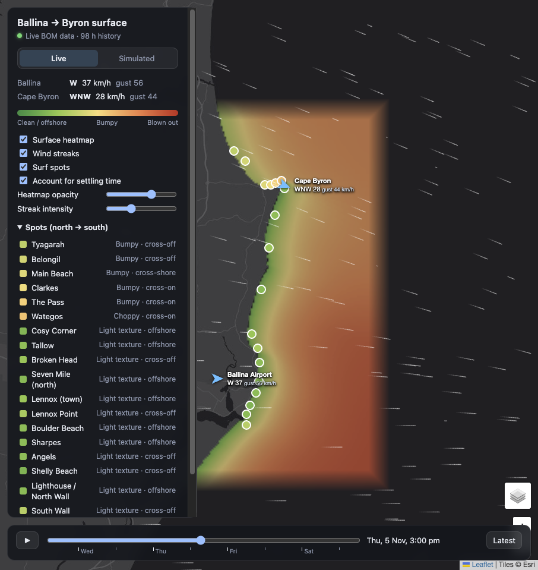

# Ballina → Byron surface conditions

A small map app that shows how clean or messy the ocean surface is between Ballina and Byron Bay, based only on the live BOM wind readings at **Ballina Airport** (94596) and **Cape Byron** (94599).



```bash
npm install
npm run dev      # http://localhost:5173
npm test
```

The dev/preview server proxies `/bom/*` to `www.bom.gov.au`, since BOM blocks cross-origin and non-browser requests. If the live feed fails, the app falls back to the snapshot in `public/sample/`.

## What you see

- **Heatmap** over the water: green = clean/offshore, yellow = bumpy, red = blown out.
- **Wind streaks**: animated, Windy-style, with an intensity slider.
- **Live / Simulated**: Live uses the BOM readings. Simulated lets you pick a wind direction, speed and gusts and see the settled result.
- **Spots**: coloured markers and a list, each tagged offshore / cross / onshore for that beach.
- **Time slider**: the ~72 h of half-hourly BOM history. Readings are also cached in `localStorage`, so history grows across visits (up to 14 days).
- Click any water for a local readout.

## Model

1. **Wind field.** Speed and direction blend smoothly along the Ballina→Byron axis: pure Ballina at/south of Ballina, pure Byron at/north of Cape Byron.
2. **Exposure (offshore + headlands).** For every 200 m water cell and every 5° of wind direction, march upwind to find the nearest land (`src/grid.ts`). Land close upwind means sheltered water (offshore, or in the lee of Lennox Head / Cape Byron). Open ocean upwind means exposed water. A ±cone of rays is averaged, so narrow headlands only partly shelter the water behind them.
3. **Target messiness** = wind strength (between "glassy below" and "blown out at", with optional gust weighting) × exposure.
4. **Settling time.** The surface relaxes towards the target: quickly when it's getting messier (build-up time), slowly when it's cleaning up (clean-up time). So an offshore morning after a night of onshore still shows leftover chop. The first few hours of the record are flagged as "spin-up".

All of these are sliders under **Model tuning**, and the values persist locally.

Not modelled: swell, tide, sandbanks, thermal/sea-breeze effects, or the cape station reading high because of its exposure.

## Coastline

`src/data/coastline.json` is built from OpenStreetMap `natural=coastline` (© OpenStreetMap contributors, ODbL):

```bash
npm run coastline:fetch   # re-download from Overpass and rebuild
npm run coastline         # rebuild from data/raw/osm-coastline.json
```
